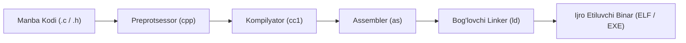

# C Dasturlash Tili: Mukammal Qo'llanma va Ensiklopediya
## (Noldan Apparat Darajasidagi Tizimli Dasturlash, Xotira Modeli va Yuqori Samaradorlikdagi Arxitekturagacha)

> **Standartlar:** C89/C90, C99, C11, C17, C23  
> **Muallif va Ekizim:** Denis Ritchi (Dennis Ritchie, Bell Labs, 1972) an'analari asosida  
> **Maqsad:** Operatsion tizimlar yadrosi (Linux Kernel), drayverlar, mikrokontrollerlar (Embedded C), ma'lumotlar bazalari (PostgreSQL, SQLite), yuqori yuklamali serverlar (Nginx) va sun'iy intellekt hisoblash dvigatellari (llama.cpp) uchun C tilini o'zbek tilida mukammal va professional darajada o'rganish.

---

## MUNDARIJA

1. [1-Bob: C Tili Falsafasi, Tarixi va Standartlar Evolyutsiyasi](#1-bob)
2. [2-Bob: Kompilyatsiya va Bajarilish Modeli (Toolchain Architecture)](#2-bob)
3. [3-Bob: Jarayon Xotira Modeli: Text, Data, BSS, Heap va Stack](#3-bob)
4. [4-Bob: Ko'rsatkichlar (Pointers) va Xotira Arxitekturasi](#4-bob)
5. [5-Bob: Dinamik Xotira va Xavfsizlik Profilaktikasi](#5-bob)
6. [6-Bob: Ma'lumot Tuzilmalari, Xotira Tekislash (Alignment) va Bit-fields](#6-bob)
7. [7-Bob: Preprocessor Metaprogramming va X-Macros](#7-bob)
8. [8-Bob: Fayllar va Kirish-Chiqish (I/O) Oqimlari](#8-bob)
9. [9-Bob: POSIX Tizim Chaqiruvlari va Ko'p Oqimlilik (Pthreads & Atomics)](#9-bob)
10. [10-Bob: O'rnatilgan Tizimlar (Embedded C) va Apparat Periferiyasi](#10-bob)
11. [11-Bob: Yuqori Samaradorlik, SIMD va Xavfsiz C Dasturlash](#11-bob)
12. [12-Bob: C Tilida Aniqlanmagan Xatti-harakatlar (Undefined Behavior) va Xulosa](#12-bob)

---

<a name="1-bob"></a>
# 1-Bob: C Tili Falsafasi, Tarixi va Standartlar Evolyutsiyasi

C tili 1972-yilda Ken Tompson (Ken Thompson) va Denis Ritchi (Dennis Ritchie) tomonidan Bell Labs laboratoriyasida UNIX operatsion tizimini qayta yozish uchun ishlab chiqilgan. Ungacha barcha operatsion tizimlar har bir protsessor uchun alohida assemblerda yozilar edi. C tili esa **"Portativ Assembler"** vazifasini o'tash uchun yaratildi.

### C Tilining Asosiy Falsafiy Tamoyillari:
1. **Dasturchiga To'liq Ishonch (Trust the Programmer):** Dasturchi xotira bilan nima qilayotganini aniq biladi deb hisoblanadi. Kompilyator ortiqcha tekshiruvlar yoki xotira chegaralarini avtomatik cheklab tezlikni tushirmaydi.
2. **Kichik va Ixcham Yadro (Small & Elegant):** Tilda keraksiz murakkabliklar yo'q. Hamma narsa sodda sintaktik konstruksiyalardan iborat.
3. **Maksimal Unumdorlik va Apparatga Yaqinlik (Zero-Overhead):** Har bir C operatori protsessorning bir yoki bir necha mashina buyrug'iga to'g'ridan-to'g'ri o'giriladi.
4. **Platformalararo Moslik (Portability):** C kodi deyarli barcha mavjud mikroprotsessorlar (x86, ARM, RISC-V, MIPS, AVR, PowerPC) uchun kompilyatsiya qilinadi.

### Standartlar Evolyutsiyasi:
* **K&R C (1978):** Brian Kernighan va Dennis Ritchie kitobi bilan tasdiqlangan birinchi norasmiy standart.
* **ANSI C / C89 / C90:** Xalqaro ISO/ANSI standarti. `void*`, funksiya prototiplari va standart kutubxona joriy etildi.
* **C99:** Butun dunyo dasturchilari sevadigan inqilobiy yangiliklar: `//` bir qatorli izohlar, `stdint.h` (`uint32_t`), `bool` tipi (`stdbool.h`), o'zgaruvchilarni sikl ichida e'lon qilish (`for (int i=0; ...)`), o'zgaruvchan uzunlikdagi massivlar (VLA), `inline` funksiyalar va `restrict` ko'rsatkichlari.
* **C11:** Ko'p oqimlilik (`threads.h`, `stdatomic.h`), `_Static_assert` (kompilyatsiya vaqtidagi tekshiruv), xotirani tekislash (`stdalign.h`), nomsiz struktura va unionlar (Anonymous structs).
* **C17 (C18):** Texnik tuzatishlar va barqarorlashtirish versiyasi (zamonaviy ishlab chiqarish standarti).
* **C23:** Zamonaviy C: `true` va `false` kalit so'zlari to'g'ridan-to'g'ri tilga kirdi, `#embed` binar resurslarni joylashtirish direktivasi, `nullptr` xavfsiz ko'rsatkichi, `constexpr` va `auto` (tipni avtomatik aniqlash).

---

<a name="2-bob"></a>
# 2-Bob: Kompilyatsiya va Bajarilish Modeli (Toolchain Architecture)

C dasturi manba kodidan to ijro etiluvchi faylgacha to'rtta aniq bosqichdan o'tadi:



1. **Preprotsessorlash (Preprocessing):**
   * `#include` qilingan sarlavha fayllarining matnini kod ichiga to'g'ridan-to'g'ri nusxalaydi.
   * `#define` makroslarini kengaytiradi va almashtiradi.
   * Izohlarni (`//` va `/* */`) tozalaydi.
   * Chiqish: Kengaytirilgan `.i` fayli.

2. **Kompilyatsiya (Compilation):**
   * Sintaktik va semantik tahlil o'tkazadi.
   * C kodini platformaga mos Assembler kodiga (`.s`) o'giradi.
   * Optimizatsiyalar (`-O2`, `-O3`, `-Os`) aynan shu bosqichda kiritiladi.

3. **Assembling:**
   * Assembler matnini apparat protsessorining ikkilik mashina kodiga (Machine Code) o'giradi.
   * Chiqish: Obyekt fayllari (`.o` yoki `.obj`). Obyekt fayl mashina kodiga ega, ammo tashqi manzillar hali ulanmagan bo'ladi.

4. **Bog'lash (Linking):**
   * Turli obyekt fayllarni, C standart kutubxonasini (`libc.a` yoki `libc.so`) va dinamik DLL larni birlashtiradi.
   * Funksiya chaqiruvlari manzillarini to'g'ri xotira koordinatalariga bog'laydi (Relocation).
   * Yakuniy binar faylni (`.exe` yoki ELF) hosil qiladi.

---

<a name="3-bob"></a>
# 3-Bob: Jarayon Xotira Modeli: Text, Data, BSS, Heap va Stack

Operatsion tizim C dasturini ishga tushirganda, har bir jarayonga 32-bit (4 GB) yoki 64-bit virtual xotira maydoni ajratiladi. Xotira qat'iy 5 ta asosiy segmentga bo'linadi:

```text
+------------------------------------------+  0xFFFFFFFF (Yuqori manzil)
|         Yadro (Kernel Space)             |
+------------------------------------------+
|                  STACK                   |  (Pastga qarab o'sadi)
|      (Lokal o'zgaruvchilar, manzillar)   |        |
|                    v                     |        v
|                                          |
|                    ^                     |        ^
|                    |                     |        |
|                  HEAP                    |  (Yuqoriga qarab o'sadi)
|        (malloc, calloc, realloc)         |
+------------------------------------------+
|                   BSS                    |
|   (Boshlang'ich qiymatsiz global/static) |  (Avtomatik 0 qilinadi)
+------------------------------------------+
|                   DATA                   |
|    (Boshlang'ich qiymatli global/static) |
+------------------------------------------+
|                   TEXT                   |
|     (Bajariluvchi Mashina Kodi, R/O)     |
+------------------------------------------+  0x00000000 (Quyi manzil)
```

1. **Text (Code) Segment:** Dasturning protsessor bajaradigan mashina buyruqlari joylashadi. Faqat o'qish uchun ruxsat berilgan (Read-Only), unga yozishga urinish Segmentation Fault beradi.
2. **Data Segment (Initsializatsiya qilingan):** Boshlang'ich qiymati berilgan global va static o'zgaruvchilar (masalan `int x = 42;`).
3. **BSS (Block Started by Symbol):** Boshlang'ich qiymat berilmagan global va static o'zgaruvchilar (masalan `static int arr[1000];`). Binar fayl ichida joy egallamaydi, dastur yuklanganda OS tomonidan barchasi avtomatik `0` qilib initsializatsiya qilinadi.
4. **Heap (Dinamik xotira):** Dastur davomida dasturchi buyrug'i bilan ajratiladigan xotira (`malloc`, `free`). Stack ga qarama-qarshi yo'nalishda (pastdan yuqoriga) o'sadi.
5. **Stack:** Funksiyalar chaqiruvlari, ularning qaytish manzillari (Return Addresses), argumentlari va lokal o'zgaruvchilarini saqlovchi o'ta tezkor xotira. Yuqoridan pastga qarab o'sadi.

---

<a name="4-bob"></a>
# 4-Bob: Ko'rsatkichlar (Pointers) va Xotira Arxitekturasi

Ko'rsatkich (Pointer) — o'zida kompyuter xotirasidagi boshqa bir o'zgaruvchining jismoniy yoki virtual manzilini (Memory Address) saqlovchi o'zgaruvchidir.

### 4.1. Asosiy Operatorlar:
* `&` (Address-of operatori): O'zgaruvchining xotiradagi manzilini oladi.
* `*` (Dereference operatori): Ko'rsatkich ishora qilib turgan manzildagi haqiqiy qiymatni o'qiydi yoki yozadi.

```c
int a = 25;
int *p = &a; // p ko'rsatkichi a ning manzilini saqlaydi
*p = 50;     // a ning qiymati 50 ga o'zgartirildi
```

### 4.2. Ko'rsatkichlar Arifmetikasi (Pointer Arithmetic)
Ko'rsatkichga son qo'shilganda yoki ayirilganda, manzil sonli qiymatga emas, balki **`sizeof(tip) * n`** baytga siljiydi:
* `int *p; p + 1;` -> Manzil `4` bayt oldinga suriladi.
* `double *p; p + 1;` -> Manzil `8` bayt oldinga suriladi.

### 4.3. Ko'rsatkich Turlari:
1. **NULL Pointer:** Hech qanday ob'ektga ishora qilmaydigan xavfsiz ko'rsatkich (`p = NULL;`).
2. **Void Pointer (`void*`):** Tipga ega bo'lmagan universal ko'rsatkich. Istalgan tipdagi manzilni qabul qiladi, ammo dereference qilishdan oldin aniq tipga keltirilishi (cast) shart.
3. **Dangling Pointer (Muallaq ko'rsatkich):** Xotirasi `free()` qilib yuborilgan, ammo manzilini hali ham saqlab turgan xavfli ko'rsatkich.
4. **Function Pointer (Funksiya ko'rsatkichi):** Kod segmentidagi funksiyaning boshlang'ich manzilini saqlovchi ko'rsatkich. Callbacklar va polimorfizm poydevori.

---

<a name="5-bob"></a>
# 5-Bob: Dinamik Xotira va Xavfsizlik Profilaktikasi

C tilida dinamik xotira `stdlib.h` kutubxonasi orqali boshqariladi:

| Funksiya | Vazifasi | Xususiyati |
|---|---|---|
| `malloc(size)` | `size` bayt xotira ajratadi | Xotira toazalanmaydi (axlat qiymatlar bo'ladi) |
| `calloc(n, size)` | `n * size` bayt xotira ajratadi | Barcha baytlarni avtomatik `0` ga tenglashtiradi |
| `realloc(ptr, new_size)` | Mavjud xotirani kengaytiradi yoki qisqartiradi | Kerak bo'lsa yangi joyga ko'chirib, eskisini o'chiradi |
| `free(ptr)` | Ajratilgan xotirani operatsion tizimga qaytaradi | Xotirani bo'shatadi, ko'rsatkichni avtomatik NULL qilmaydi |

### Xotira Boshqaruvidagi Eng Xavfli 4 Ta Xato:
1. **Memory Leak (Xotira oqishi):** `malloc` qilingan xotirani `free` qilmasdan dasturni davom ettirish. RAM to'lib ketishiga olib keladi.
2. **Double Free (Ikki marta bo'shatish):** Bitta xotira manziliga ikki marta `free()` chaqirish (Heap corruption crash).
3. **Use-After-Free (UAF):** Bo'shatilgan xotiraga qayta yozish yoki o'qish (xakerlar uchun tizimni buzish yo'li).
4. **Buffer Overflow (Bufer to'lib ketishi):** Ajratilgan xotira chegarasidan tashqariga yozish.

> **Professional Qoida:** Har doim `free(p)` dan so'ng darhol `p = NULL;` qilib qo'yish shart!

---

<a name="6-bob"></a>
# 6-Bob: Ma'lumot Tuzilmalari, Xotira Tekislash (Alignment) va Bit-fields

### 6.1. Xotira Tekislash (Data Alignment & Structure Padding)
Zamonaviy protsessorlar xotiradan ma'lumotni 4 yoki 8 baytga karrali manzillardan o'qiganda eng yuqori tezlikka erishadi. Shu sababli kompilyator struktura a'zolari orasiga bo'shliqlar (Padding) qo'shadi:

```c
struct Sinov {
    char a;    // 1 bayt
    // 3 bayt PADDING qo'shiladi!
    int b;     // 4 bayt
    char c;    // 1 bayt
    // 3 bayt PADDING qo'shiladi!
}; // Jami sizeof = 12 bayt! (6 bayt emas)
```

### 6.2. Bit-Fields (Bit Maydonlari)
Bayt ichidagi bitlarni alohida nomlangan maydonlarga bo'lish imkoniyati:

```c
struct IPHeaderFlags {
    unsigned int reserved : 1; // 1 bit
    unsigned int df       : 1; // Don't Fragment (1 bit)
    unsigned int mf       : 1; // More Fragments (1 bit)
    unsigned int offset   : 13;// 13 bit
}; // Barchasi 16 bit (2 bayt) ichida ixcham saqlanadi!
```

---

<a name="7-bob"></a>
# 7-Bob: Preprocessor Metaprogramming va X-Macros

C preprotsessori kompilyatsiyadan oldin kod ustida tekstual amallarni bajaradi.

### 7.1. Makros Qoidalari
* Har doim argumentlarni va umumiy ifodani qavsga oling: `#define SQ(x) ((x) * (x))`
* Ko'p qatorli makroslarni `do { ... } while(0)` blokiga oling.
* `#` operatori argumentni satrga (string) aylantiradi.
* `##` operatori ikkita tokenni bitta identifikatorga ulaydi.

### 7.2. X-Macros Texnikasi
Bitta ro'yxatdan bir vaqtning o'zida `enum`, `massiv` va `switch-case` larni avtomatik generatsiya qilish usuli:

```c
#define COLOR_LIST \
    X(RED, "Qizil") \
    X(GREEN, "Yashil") \
    X(BLUE, "Ko'k")

// Enum hosil qilish
typedef enum {
    #define X(id, str) COLOR_##id,
    COLOR_LIST
    #undef X
} Color;
```

---

<a name="8-bob"></a>
# 8-Bob: Fayllar va Kirish-Chiqish (I/O) Oqimlari

C tilida barcha kiritish-chiqarish amallari oqimlar (Streams) orqali amalga oshiriladi:
* `stdin` (standart kirish oqimi - klaviatura)
* `stdout` (standart chiqish oqimi - qatorli buferlangan konsol)
* `stderr` (standart xatolik oqimi - bufersiz zudlik bilan chiquvchi oqim)

### Fayl Rejimlari:
* `"r"` / `"w"` / `"a"` — Matnli o'qish, yozish va qo'shish.
* `"rb"` / `"wb"` / `"ab"` — Binar o'qish, yozish va qo'shish.
* `fread` va `fwrite` — Diskka butun boshli massivlar va strukturalarni bitta buyruqda yozish va o'qish.
* `fseek` va `ftell` — Fayl ichida ixtiyoriy baytga sakrash (Random Access Database arxitekturasi).

---

<a name="9-bob"></a>
# 9-Bob: POSIX Tizim Chaqiruvlari va Ko'p Oqimlilik (Pthreads & Atomics)

C tili operatsion tizim yadrosining eng yaqin hamkori hisoblanadi.

### 9.1. Jarayonlar (Processes)
* `fork()` — Jarayonning to'liq nusxasini (bola jarayon) yaratadi.
* `exec*()` — Joriy jarayon xotirasiga yangi dasturni yuklaydi.
* `pipe()` — Jarayonlar o'rtasida ma'lumot uzatish quvuri.

### 9.2. POSIX Threads (Oqimlar)
* `pthread_create()` — Umumiy xotira maydonida parallel yengil oqim ochadi.
* `pthread_mutex_t` — Poyga holatini (Race Condition) oldini oluvchi o'zaro istisno qulfi.
* `pthread_cond_t` — Oqimlarni voqea sodir bo'lguncha passiv kutish holatiga qo'yadi.
* `stdatomic.h` (C11) — Apparat darajasidagi Lock-Free atomik hisoblagichlar.

---

<a name="10-bob"></a>
# 10-Bob: O'rnatilgan Tizimlar (Embedded C) va Apparat Periferiyasi

Mikrokontrollerlarda (STM32, ESP32, AVR, PIC) C dasturlashning o'ziga xos qoidalari:
1. **Memory-Mapped I/O:** Har bir periferiya (GPIO, UART, Timer, ADC) xotiradagi ma'lum manzilga bog'langan.
2. **`volatile` kalit so'zi:** Registr qiymati dastur tashqarisida (apparat tomonidan) o'zgarishi mumkin bo'lgani uchun har doim `volatile uint32_t *` ishlatiladi.
3. **Interrupt Service Routine (ISR):** Uzilishlar funksiyasi mikrosekundlarda bajarilishi va hech qachon sekinlashtiruvchi amallarni (printf, malloc) bajarmasligi shart.
4. **Apparat Protokollari:** UART (ketma-ket), SPI (yuqori tezlikdagi sinxron), I2C (2 simli ko'p datchikli shina).

---

<a name="11-bob"></a>
# 11-Bob: Yuqori Samaradorlik, SIMD va Xavfsiz C Dasturlash

### 11.1. Keshga Mos (Cache-Friendly) Dasturlash
Zamonaviy protsessorlarda RAM dan ma'lumot olish 200 takt, L1 keshdan olish esa 4 takt vaqt oladi.
* 2D massivlarni har doim qatorlar bo'yicha (Row-major) aylanib chiqing.
* Strukturalar massivini (Array of Structures - AoS) zarur bo'lganda massivlar strukturasiga (Structure of Arrays - SoA) almashtiring.

### 11.2. SIMD (Single Instruction Multiple Data)
Protsessorning AVX2 va NEON vektorli registrlari orqali 8 ta suzuvchi nuqtali sonni bitta siklda ko'paytirish va qo'shish imkoniyati.

### 11.3. Zamonaviy AI va Neyron Tarmoqlar: 1-Bit LLM Kernel (BitNet)
Zamonaviy sun'iy intellekt modellarini (masalan llama.cpp va BitNet) C tilida tezlashtirish uchun sonlar 1-bit yoki 8-bit (INT8) ga kvantlanadi va ko'paytirishlar oddiy bitwise XOR va Popcount amallariga aylantiriladi.

---

<a name="12-bob"></a>
# 12-Bob: C Tilida Aniqlanmagan Xatti-harakatlar (Undefined Behavior) va Xulosa

**Undefined Behavior (UB)** — C tilining eng xatarli tushunchasidir. Agar kodda UB yuz bersa, C standarti dastur nima qilishini kafolatlamaydi (u ishlashi, noto'g'ri natija berishi yoki qulashi mumkin).

### Eng Mashhur UB Holatlari:
1. Nulga bo'lish (`x / 0`).
2. Belgili butun sonlarning to'lib ketishi (`INT_MAX + 1`).
3. Initsializatsiya qilinmagan o'zgaruvchini o'qish.
4. NULL yoki muallaq (dangling) ko'rsatkichni dereference qilish.
5. Massiv chegarasidan tashqariga yozish (Out-of-bounds).
6. Bitta ifoda ichida o'zgaruvchini bir necha bor o'zgartirish (`i = i++ + ++i`).

### XULOSA:
C tili — bu dasturlash olamining poydevori, barcha zamonaviy texnologiyalarning ildizidir. Ushbu mukammal qo'llanma va 1,000 ta amaliy topshiriqdan iborat ta'limiy dataset sizga C tilining barcha ichki mexanizmlarini noldan boshlab eng yuqori darajagacha egallashga to'liq imkon beradi!
