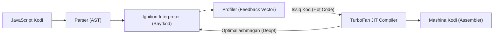
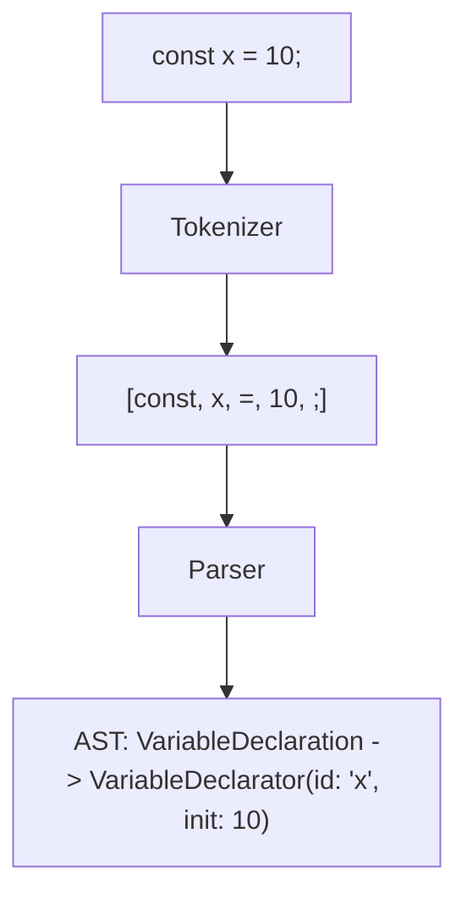
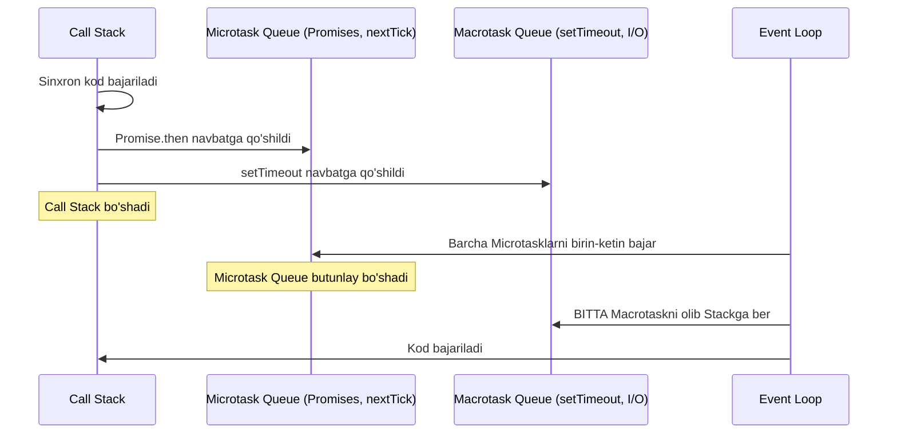

# JavaScript (ES6+) va TypeScript Mukammal Ensiklopedik Qo'llanmasi

## Kirish
Ushbu ensiklopediya zamonaviy JavaScript (ES6+) va TypeScript ekotizimining chuqur nazariy va amaliy arxitekturasini, V8 dvigateli mexanikasini, Just-In-Time (JIT) kompilyatsiyasini, Abstract Syntax Tree (AST) tuzilishini, xotira menejmentini hamda korporativ darajadagi Fullstack va AI Agent integratsiyalarini to'liq qamrab olgan eng mukammal ta'limiy qo'llanmadir.

---

## 1-BOB: JavaScript va TypeScript Tarixi hamda Evolyutsiyasi

### 1.1. LiveScript dan ECMAScript gacha
1995-yilda Netscape kompaniyasi muhandisi **Brendan Eich** tomonidan atigi 10 kun ichida ishlab chiqilgan "Mocha" tili dastlab "LiveScript", keyinchalik esa marketing maqsadida "JavaScript" deb nomlandi. 1997-yilda tilni standartlashtirish maqsadida **ECMA International** tashkilotiga topshirildi va rasmiy **ECMAScript** standarti vujudga keldi.

### 1.2. ES6 (ECMAScript 2015) Inqilobi
2015-yil JavaScript tarixidagi eng katta burilish nuqtasi bo'ldi:
- `let` va `const` yordamida Block Scope joriy qilindi.
- `class` sintaksisi orqali prototipga asoslangan OOP qulay o'ramga ega bo'ldi.
- Arrow functions (`() => {}`), Promises, Destructuring, Spread/Rest (`...`), Default parameters va Modullar (`import`/`export`) standartga kiritildi.
- Shundan so'ng ECMA har yili (ES2016, ES2017, ...) yangi imkoniyatlar qo'shib boradigan yillik relizlar tsikliga o'tdi.

### 1.3. TypeScript ning Paydo Bo'lishi va Zafari
2012-yilda Microsoft kompaniyasi va **Anders Hejlsberg** (Turbo Pascal, Delphi va C# tillari bosh me'mori) tomonidan taqdim etilgan **TypeScript** - JavaScriptning statik tiplangan qat'iy ustqurmasi (superset) hisoblanadi. TypeScript JavaScript-ning dinamik zaifliklarini (runtime xatolari, refaktoring qiyinligi, katta loyihalarda boshqaruv yo'qolishi) bartaraf etib, korporativ dasturiy ta'minot bozorining mutlaq standartiga aylandi.

---

## 2-BOB: V8 Dvigateli Arxitekturasi va Just-In-Time (JIT) Kompilyator

V8 - Google tomonidan C++ tilida yozilgan, Google Chrome, Node.js, Deno va Electron kabi gigant platformalarning yuragi bo'lgan o'ta yuqori unumdorlikka ega JavaScript dvigatelidir.



### 2.1. Ignition (Interpretor)
V8 dastlab JavaScript manba kodini to'g'ridan-to'g'ri mashina kodiga aylantirmaydi. Chunki mashina kodi juda katta xotira talab qiladi. Buning o'rniga:
1. Parser manba kodni Abstract Syntax Tree (AST) ga aylantiradi.
2. **Ignition** interpreteri ushbu AST dan ixcham va samarali **Baytkod (Bytecode)** generatsiya qiladi.
3. Baytkod darhol bajarila boshlaydi, bu esa ilovaning boshlanish (Startup Time) vaqtini bir necha barobar tezlashtiradi.

### 2.2. TurboFan (Optimallashtiruvchi JIT Kompilyatori)
Ignition baytkodlarni bajarish davomida **Type Feedback** (tiplar bo'yicha statistik ma'lumotlar) to'playdi.
- Agar ma'lum bir funksiya yoki sikl juda ko'p chaqirilsa, u **"Hot Function"** deb belgilanadi.
- TurboFan ushbu funksiyani olib, to'plangan tiplar statistikasi (masalan, funksiya har doim 32-bitli integer qabul qilishi) asosida optimallashtirilgan mashina kodiga (**Optimized Machine Code**) aylantiradi.
- Natijada ushbu kod xuddi C++ yoki Rust tilidek to'g'ridan-to'g'ri protsessor tezligida ishlaydi.

### 2.3. Deoptimizatsiya (Deoptimization / Bailout)
JavaScript dinamik til bo'lgani sababli, dasturchi har doim son qabul qilgan funksiyaga to'satdan string berishi mumkin:
```typescript
function add(a, b) { return a + b; }
// 10 000 marta add(1, 2) chaqirildi -> TurboFan integer mashina kodi yasadi
add("salom", "dunyo"); // Kutilmagan tip!
```
Ushbu holatda TurboFan o'z taxminlari buzilganligini ko'radi va **Deopt (Deoptimization)** sodir bo'ladi: optimallashtirilgan mashina kodi bekor qilinadi va bajarilish yana xavfsiz Ignition interpreteri darajasiga qaytariladi. Doimiy deoptlar kod unumdorligini jiddiy tushiradi.

---

## 3-BOB: Kompilyatsiya Bosqichlari va AST (Abstract Syntax Tree)

Har qanday JavaScript yoki TypeScript fayli bajarilishidan oldin quyidagi qat'iy leksik va sintaktik konveyerdan o'tadi:

1. **Leksik Tahlil (Lexical Analysis / Tokenizer):**
   Manba kod belgilardan iborat qator bo'lib, Tokenizer uni ma'noli bo'laklarga — **Tokenlarga** ajratadi (`Keyword`, `Identifier`, `Operator`, `Literal`).
2. **Sintaktik Tahlil (Syntactic Analysis / Parser):**
   Tokenlar ketma-ketligi grammatika qoidalariga solishtirilib, ierarxik daraxt — **Abstract Syntax Tree (AST)** ga aylantiriladi.
3. **AST ning Amaliy Ahamiyati:**
   Babel, ESLint, Prettier, TypeScript Compiler (`tsc`), SWC va Vite kabi barcha vositalar bevosita AST ni o'qish, tahlil qilish va o'zgartirish orqali ishlaydi.



---

## 4-BOB: Xotira Menejmenti va Garbage Collection (Xotira Tozalash)

JavaScript xotirani avtomatik boshqaradi (Automatic Memory Management). Biroq, xotira tuzilishini tushunmaslik "Memory Leak" (xotira sizib chiqishi) kabi og'ir falokatlarga olib keladi.

### 4.1. Stack vs Heap
- **Stack (Stek):** Primitiv qiymatlar (`number`, `boolean`, `symbol`) va funksiya chaqiruvlari kadrlari (Stack Frames) saqlanadi. O'lchami qat'iy belgilangan, juda tez ishlaydi (LIFO).
- **Heap (Uyum):** Dinamik kattalikdagi murakkab obyektlar, massivlar, funksiyalar va closurelar saqlanadi. Xotiradan dinamik ajratiladi.

### 4.2. V8 Garbage Collector: Generational Hypothesis
Statistikaga ko'ra, dasturdagi obyektlarning 90% dan ortig'i yaratilgandan so'ng juda qisqa vaqt ichida o'z ahamiyatini yo'qotadi ("Young Generation"). Shuning uchun V8 xotirani ikki qismga bo'ladi:
1. **Young Generation (Yosh avlod):**
   - **Scavenger (Minor GC)** algoritmi bilan tozalanadi.
   - Xotira teng ikki bo'lakka bo'linadi: *From-Space* va *To-Space*.
   - Faol (tirik) obyektlar To-Space ga ko'chiriladi, qolgan barcha bo'shliq bir zumda tozalanadi.
   - Ikki marta tozalashdan omon qolgan obyektlar *Old Generation* ga ko'chiriladi (Evacuation).
2. **Old Generation (Eski avlod):**
   - Uzoq umr ko'ruvchi obyektlar bu yerda yashaydi.
   - **Major GC (Full Mark-Sweep-Compact)** algoritmi orqali tozalanadi:
     - *Marking:* Ildizdan (Root) boshlab barcha yetish mumkin bo'lgan obyektlar belgilanadi.
     - *Sweeping:* Belgilanmagan (o'lik) obyektlar xotiradan bo'shatiladi.
     - *Compacting:* Xotira parchalanishini (fragmentation) yo'qotish uchun tirik obyektlar xotiraning boshiga ixcham yig'iladi.

### 4.3. Asosiy Xotira Sizib Chiqishi (Memory Leak) Sabablari
- **Global o'zgaruvchilar:** `window.leak = ...` kabi unutilgan global obyektlar hech qachon GC tomonidan o'chirilmaydi.
- **Bekor qilinmagan hodisalar (Dangling Event Listeners):** DOM element o'chirilsa-da, uning `addEventListener` obunasi tozalab tashlanmasa (`removeEventListener`).
- **Unutilgan taymerlar:** `setInterval` to'xtatilmasa (`clearInterval`), uning closure ichidagi o'zgaruvchilar abadiy xotirada saqlanadi.
- **Yopiq Closurelar:** Tashqi katta ma'lumotlarni o'zida ushlab qolgan yordamchi funksiyalar.

---

## 5-BOB: Event Loop, Concurrency va Asinxronlik Chuqurligi

JavaScript **Single-Threaded** (bitta asosiy ipga ega) til bo'lishiga qaramay, u **Non-blocking I/O** arxitekturasi tufayli o'n minglab parallel tarmoq so'rovlarini boshqara oladi.



### 5.1. Navbatlar Ierarxiyasi va Ustuvorligi
Har safar bitta sinxron kod bloki bajarilib, Call Stack bo'shaganda, Event Loop quyidagi qat'iy tartibda ishlaydi:
1. **process.nextTick (Node.js):** Eng yuqori ustuvorlikka ega mikrotask.
2. **Microtask Queue:** `Promise.then/catch/finally`, `queueMicrotask`, `MutationObserver`. **DIQQAT:** Microtask navbati butunlay bo'shatilmaguniga qadar keyingi bosqichga o'tilmaydi!
3. **Animation Frames (Brauzerda):** `requestAnimationFrame` ekranni qayta chizishdan oldin ishlaydi.
4. **Macrotask (Task) Queue:** `setTimeout`, `setInterval`, `setImmediate`, I/O hodisalari. Event Loop har bir aylanishda macrotask navbatidan **faqat bitta** vazifani olib bajaradi, so'ngra darhol yana Microtask navbatini tekshirishga qaytadi.

---

## 6-BOB: TypeScript Kompilyator Arxitekturasi va Tip Nazariyasi

TypeScript kompilyatori (`tsc`) oddiy kod tekshiruvchisi emas, balki murakkab matematik Tip Nazariyasiga (Type Theory) asoslangan ilg'or platformadir.

### 6.1. Kompilyatsiya Bosqichlari
- **Scanner:** Manba matnni tokenlarga ajratadi.
- **Parser:** Tokenlardan TypeScript AST hosil qiladi.
- **Binder:** Identifikatorlar va doiralarni (scopes) Symbol Table ga bog'laydi.
- **Checker:** Tiplarni o'zaro solishtiradi, tiplar mosligini, cheklovlarni (constraints) tekshiradi (kompilyatsiyaning eng og'ir 80% vaqtini oladi).
- **Emitter:** Tiplarni olib tashlab (Type Erasure), toza JavaScript kodi (`.js`) va deklaratsiya fayllarini (`.d.ts`) hosil qiladi.

### 6.2. Strukturaviy Tiplash (Structural Subtyping)
Nominal tillardan (Java, C#) farqli o'laroq, TypeScript **"Duck Typing"** tamoyiliga asoslanadi:
> "Agar u o'rdakka o'xshab yursa va o'rdakka o'xshab vaysasa, demak u o'rdakdir."

Agar ikki obyektning xossalari va ularning tiplari bir-biriga mos kelsa, ular qaysi sinf yoki interfeysdan yaratilganidan qat'i nazar, bir-birining o'rnida ishlatilishi mumkin.

### 6.3. Kovariantlik va Kontravariantlik (Variance)
- **Kovariantlik (Covariance):** Qaytish tiplari (Return types) kovariantdir. Torroq tip qaytaruvchi funksiya kengroq tip kutayotgan joyga berilishi mumkin.
- **Kontravariantlik (Contravariance):** Funksiya parametrlari (`strictFunctionTypes` ostida) kontravariantdir. Kengroq tip qabul qiluvchi funksiya torroq parametr kutayotgan funksiya o'rniga berilishi mumkin.

---

## 7-BOB: Zamonaviy Frontend va Backend Arxitekturasi

### 7.1. Fullstack Next.js App Router va Server Actions
- **Server Components (RSC):** Backendda render qilinadi, mijozga nol bayt JavaScript jo'natadi, ma'lumotlar bazasiga to'g'ridan-to'g'ri ulanadi.
- **Client Components ('use client'):** Faqat interaktiv hodisalar (`onClick`, `useState`, `useEffect`) uchun ishlatiladi.
- **Server Actions ('use server'):** REST endpoint yozmasdan to'g'ridan-to'g'ri shakllar (forms) va mutatsiyalarni type-safe amalga oshiradi.

### 7.2. End-to-End Type Safety: tRPC va Zod
Backend va Frontend o'rtasida API shartnomasini ta'minlash:
- Zod kiruvchi ma'lumotlarni runtime darajasida tekshiradi.
- tRPC ushbu Zod sxemalari orqali Frontend uchun avtomatik tiplangan so'rov vositalarini beradi.
- Natijada backenddagi bitta maydon o'zgarsa, frontendda darhol qizil kompilyatsiya xatosi chiqadi!

---

## 8-BOB: Zamonaviy AI Agent Arxitekturasi va LLM Integratsiyalari

Sun'iy Intellekt davrida TypeScript AI Agentlarni qurishning asosiy dasturlash tiliga aylandi.

### 8.1. ReAct (Reasoning + Acting) Agent Sikli
AI Agent shunchaki savol-javob boti emas; u mustaqil qaror qabul qiluvchi dastur:
1. **Fikr (Thought):** Foydalanuvchi maqsadini tahlil qiladi va qaysi harakat kerakligini rejalashtiradi.
2. **Harakat (Action / Tool Call):** Tashqi API, Ma'lumotlar bazasi yoki kalkulyator vositasini (`tools`) parametrlar bilan chaqiradi.
3. **Kuzatuv (Observation):** Vosita qaytargan natijani o'qiydi.
4. **Xulosa (Final Response):** Agar maqsadga erishilgan bo'lsa, foydalanuvchiga to'liq javobni taqdim etadi, aks holda yangi sikl boshlaydi.

### 8.2. Vector Embeddings va RAG Arxitekturasi
Katta hajmdagi korporativ ma'lumotlarni LLM ga xavfsiz yetkazish:
- Hujjatlar bo'laklarga (chunks) ajratiladi.
- Har bir bo'lak Embeddings modeli orqali ko'p o'lchovli sonli vektorlarga (`float[]`) aylantiriladi.
- Vektor omborida **Cosine Similarity** orqali foydalanuvchi savoliga eng yaqin hujjatlar topiladi va prompt kontekstiga biriktirilib modelga beriladi.

### 8.3. Token Streaming va Server-Sent Events (SSE)
Katta hajmdagi matnlar generatsiyasida foydalanuvchini kuttirmaslik uchun HTTP SSE protokoli orqali har bir token hosil bo'lishi bilanoq real vaqtda uzatiladi.

---

## Xulosa va Kelajak
JavaScript va TypeScript bugungi kunda dunyodagi eng ommabop, dinamik rivojlanayotgan va qudratli dasturlash ekotizimidir. Ushbu qo'llanmada keltirilgan chuqur arxitektura tamoyillari, V8 dvigateli mexanikasi va ilg'or tiplash metodologiyalari har bir muhandisga yuqori sifatli, kengayuvchan va xatosiz korporativ dasturlar hamda zamonaviy avtonom AI tizimlarini yaratishda mustahkam poydevor bo'lib xizmat qiladi.
