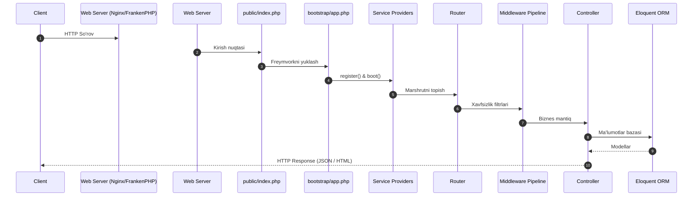

# PHP va Laravel Ekotizimi: Mukammal Ensiklopedik Qo'llanma
## (Noldan Yuqori Yuklamali Tizimlar, Zend Engine, JIT, Modern OOP, Laravel 11, Xavfsizlik va AI Agent Backend)

> **Muallif:** Khorazmiy AI Ilmiy Ta'limiy Jamoasi  
> **Standart:** PHP 8.3+ / 8.4 va Laravel 11+  
> **Asosiy yo'nalish:** Zend Engine virtual mashinasi, xotira modeli (Zval, COW, GC), JIT kompilyatori, qat'iy tiplash, ilg'or OOP va Dizayn Patternlar, Composer va PSR standartlari, Laravel 11 arxitekturasi, Eloquent ORM, Reverb WebSockets, Kiberxavfsizlik (OWASP, Kriptografiya) hamda Sun'iy Intellekt (RAG, Vector Embeddings, ReAct AI Agent) backend integratsiyasi.

---

## MUNDARIJA

1. [1-Bob: PHP Tarixi, Falsafasi va Zamonaviy Inqilobi](#1-bob)
2. [2-Bob: Zend Engine Arxitekturasi va Ijro Modeli](#2-bob)
   - Lexing, Parsing, Abstract Syntax Tree (AST)
   - Opcodes va Zend Virtual Machine (VM)
   - OPcache va Shared Memory keshlanishi
   - JIT (Just-In-Time) Kompilyatsiyasi: Tracing JIT va Function JIT
3. [3-Bob: Xotira Boshqaruvi va Garbage Collector (GC)](#3-bob)
   - Zval (Zend Value) strukturasi va xotira turlari
   - Copy-on-Write (COW) tamoyili
   - Reference Counting va Aylanma bog'lanishlarni tozalash (Cycle Collector)
4. [4-Bob: Qat'iy Tiplash Tizimi va PHP 8.0-8.3 Evolyutsiyasi](#4-bob)
   - declare(strict_types=1) va Type Coercion farqi
   - Union, Intersection va Disjunctive Normal Form (DNF) Tiplar
   - Enums (Pure va Backed Enums), Match ifodasi, Fibers
5. [5-Bob: Zamonaviy OOP va Metadasturlash](#5-bob)
   - Constructor Property Promotion, Readonly Properties va Readonly Classes
   - Sehrli metodlar (Magic Methods) to'liq tahlili
   - Reflection API va PHP Attributes (#[Attribute])
6. [6-Bob: SOLID Prinsiplari va Dizayn Patternlar](#6-bob)
   - Single Responsibility, Open/Closed, Liskov Substitution, Interface Segregation, Dependency Inversion
   - GoF dizayn naqshlari (Singleton, Factory, Adapter, Decorator, Strategy, Observer)
   - Dependency Injection (DI) Container va Service Locator muammosi
7. [7-Bob: Composer va PSR (PHP Standard Recommendations) Ekotizimi](#7-bob)
   - PSR-1, PSR-12 (Coding Style)
   - PSR-4 (Autoloading) arxitekturasi va vendor tuzilishi
   - PSR-7, PSR-15 (HTTP Messages & Middleware) va PSR-11 (Container)
8. [8-Bob: Laravel 11 Freymvorki Arxitekturasi va Request Lifecycle](#8-bob)
   - So'rov hayot sikli: public/index.php dan to Response gacha
   - Service Container va Service Providers
   - Facades mexanizmi va ularning ichki ishlash mantig'i
   - Marshrutlash va bootstrap/app.php konfiguratsiyasi
9. [9-Bob: Eloquent ORM va Relyatsion Ma'lumotlar Muhandisligi](#9-bob)
   - Active Record tamoyili vs Data Mapper
   - Relyatsion munosabatlar (1:1, 1:N, N:M, Polymorphic)
   - N+1 so'rovlar muammosi va Eager Loading (with, load)
   - Scopes, Accessors & Mutators (Attribute::make), Observers
10. [10-Bob: Asinxron Vazifalar, Queues va Real-time WebSockets](#10-bob)
    - Navbatlar arxitekturasi (Database, Redis, SQS)
    - Job Batching va Chaining
    - Real-time Broadcasting va Laravel Reverb WebSocket serveri
    - Asinxron PHP drayverlari (Swoole, RoadRunner, FrankenPHP)
11. [11-Bob: Kiberxavfsizlik va Kriptografiya](#11-bob)
    - OWASP Top 10 profilaktikasi (SQL Injection, XSS, CSRF, Clickjacking)
    - Parollar xavfsizligi: Bcrypt, Argon2id, Timing Attack (hash_equals)
    - OpenSSL simmetrik shifrlash (AES-256-CBC / GCM) va Webhook HMAC imzolari
12. [12-Bob: Sun'iy Intellekt (AI) va Avtonom Agent Backend Integratsiyasi](#12-bob)
    - LLM API lar (Gemini, OpenAI) bilan ishlash va SSE Streaming
    - Vektor embeddinglar va Semantik qidiruv (pgvector, Cosine similarity)
    - RAG (Retrieval-Augmented Generation) tizimi
    - Function Calling va PHP da Avtonom AI Agentlari (ReAct sikli)
13. [13-Bob: Unumdorlikni Oshirish, Profiling va Production Best Practices](#13-bob)
    - OPcache Preloading va JIT sozlamalari
    - Laravel Octane bilan soniyasiga 10,000+ RPS
    - PHPStan (Level Max), Pest/PHPUnit testlari va CI/CD

---

## 1-Bob: PHP Tarixi, Falsafasi va Zamonaviy Inqilobi

PHP (dastlab **Personal Home Page**, bugungi kunda esa rekursiv qisqartma sifatida **PHP: Hypertext Preprocessor**) 1994-yilda **Rasmus Lerdorf** tomonidan C tilida yozilgan oddiy CGI skriptlari to'plami sifatida dunyoga kelgan.

### Asosiy Evolyutsiya Bosqichlari:
1. **PHP 1.0 - 2.0 (1994 - 1997):** Oddiy veb shakllari va tashrif buyuruvchilarni hisoblash vositasi.
2. **PHP 3.0 (1998):** **Andi Gutmans** va **Zeev Suraski** PHP ni noldan qayta yozib, birinchi rasmiy modulli tildan iborat parserni yaratishdi.
3. **PHP 4.0 (2000):** **Zend Engine 1.0** (Zeev + Andi) dvigateli taqdim etildi. Sessiyalar va buferlash paydo bo'ldi.
4. **PHP 5.0 (2004 - 2014):** **Zend Engine 2.0**. Zamonaviy to'laqonli OOP (sinflar, interfeyslar, private/protected/public, istisnolar, SPL) joriy etildi.
5. **PHP 7.0 inqilobi (2015):** PHPNG (PHP Next Generation) asosidagi **Zend Engine 3.0**. Xotira sarfi 50% ga qisqardi, ishlash tezligi **2 barobar oshdi**. Qat'iy skalyar tiplash va Abstract Syntax Tree (AST) qo'shildi.
6. **PHP 8.0 - 8.3 (2020 - hozirgacha):** **Zend Engine 4.0** va **JIT (Just-In-Time) Compiler**. Attributes, Match ifodasi, Union va Intersection tiplar, Enums, Readonly classes, Fibers, json_validate kabi inqilobiy yangiliklar.

Bugungi kunda butun dunyo veb-saytlarining **76% dan ortig'i** (jumladan Wikipedia, WordPress, Facebook, Slack, Mailchimp) aynan PHP asosida ishlaydi. Zamonaviy PHP 8.3 - bu yuqori tezlikka ega, qat'iy tiplangan va murakkab taqsimlangan tizimlarga mo'ljallangan qudratli korporativ tildir.

---

## 2-Bob: Zend Engine Arxitekturasi va Ijro Modeli

PHP interpretatsiya qilinadigan til deb atalsa-da, u C yoki C++ kabi har safar matnni to'g'ridan-to'g'ri o'qimaydi. U zamonaviy virtual mashinaga (Zend VM) ega bo'lib, quyidagi 4 bosqichli ijro konveyeridan o'tadi:


### 1. Lexing (Tokenizatsiya)
`re2c` vositasida yozilgan Lexer PHP kodini alohida ma'noli bo'laklarga — **Tokenlar**ga (`T_VARIABLE`, `T_STRING`, `T_ECHO`) ajratadi. Dasturchi buni `token_get_all()` orqali ko'rishi mumkin.

### 2. Parsing va AST (Abstract Syntax Tree)
`Bison` LALR(1) grammatik analizatori tokenlarni qabul qilib, ulardan ierarxik daraxt — **AST** (mavhum sintaksis daraxti) tuzadi. AST sintaktik xatoliklarni (`ParseError`) darhol aniqlaydi.

### 3. Kompilyatsiya va Opcodes
AST kompilyator tomonidan **Zend Opcodes** (operatsion kodlar) ketma-ketligiga o'giriladi. Har bir opcode:
- `opcode`: Bajarilishi kerak bo'lgan buyruq (masalan, `ZEND_ADD`, `ZEND_ECHO`, `ZEND_INIT_FCALL`).
- `op1`, `op2`: Operandlar.
- `result`: Natija saqlanadigan xotira registri.

### 4. OPcache va Shared Memory
Har bir HTTP so'rovda yuqoridagi 3 bosqichni qayta bajarmaslik uchun **OPcache** kengaytmasi Opcodes ni operativ xotirada (Shared Memory / SHM) saqlab qo'yadi. Natijada keyingi so'rovlar kompilyatsiya bosqichini butunlay chetlab o'tib, to'g'ridan-to'g'ri mashina tezligida Zend VM ga uzatiladi.

### 5. JIT (Just-In-Time) Kompilyatori
PHP 8.0 da Zend VM ichiga DynASM asosidagi **JIT Compiler** qo'shildi:
- **Function JIT:** Butun funksiyani mashina kodiga (x86-64 / ARM64) aylantiradi.
- **Tracing JIT:** Eng ko'p takrorlanuvchi qisqa sikllarni ("hot code") aniqlab, ularni protsessorning to'g'ridan-to'g'ri mashina ko'rsatmalariga o'giradi. Bu matematik va AI hisob-kitoblarida unumdorlikni bir necha barobarga oshiradi.

---

## 3-Bob: Xotira Boshqaruvi va Garbage Collector (GC)

PHP xotirani avtomatik boshqaruvchi (Automatic Memory Management) til bo'lib, uning asosi **Zval** va **Reference Counting** mexanizmlariga tayanadi.

### Zval (Zend Value) Strukturasi
PHP 7 dan boshlab har bir o'zgaruvchi xotirada 16 baytli `_zval_struct` ko'rinishida saqlanadi:
- `value`: Haqiqiy qiymat (butun son, float, yoki ko'rsatkich).
- `u1.type`: O'zgaruvchi turi (`IS_UNDEF`, `IS_NULL`, `IS_FALSE`, `IS_TRUE`, `IS_LONG`, `IS_DOUBLE`, `IS_STRING`, `IS_ARRAY`, `IS_OBJECT`).
- `u2.refcount`: Ushbu xotira manziliga nechta ko'rsatkich havola qilib turganini bildiruvchi sanagich.

### Copy-on-Write (COW) Tamoyili
PHP xotirani haddan tashqari ko'p nusxalashdan asrash uchun COW prinsipidan foydalanadi:
```php
$a = range(1, 1000000); // Katta massiv (taxminan 30 MB)
$b = $a;                // Yangi xotira olinmaydi! $a va $b bitta Zval ga ishora qiladi (refcount = 2)
$b[] = 999;             // Aynan shu lahzada o'zgarish sodir bo'lgani uchun xotira nusxalanadi (Copy on Write)
```

### Reference Counting va Cycle Collector
Har safar o'zgaruvchiga yangi havola berilganda `refcount++` bo'ladi, `unset()` qilinganda esa `refcount--` bo'ladi. `refcount === 0` bo'lgan zahoti xotira darhol operatsion tizimga qaytariladi.

Biroq obyektlar bir-biriga aylanma havola (circular reference: A -> B va B -> A) qilganda oddiy refcounting ularni tozalay olmaydi. Buni bartaraf etish uchun PHP ning **Cycle Collector** mexanizmi shubhali obyektlarni "Root Buffer" (10,000 ta element) ga yig'adi va **Concurrent Cycle Collection** algoritmi orqali aylanma qoldiq xotirani davriy tozalab turadi.

---

## 4-Bob: Qat'iy Tiplash Tizimi va PHP 8.0-8.3 Evolyutsiyasi

PHP o'z tarixidagi zaif tiplangan (dynamically typed) tildan bugungi kunda dunyodagi eng ilg'or gibrid tiplash tizimlaridan biriga aylandi.

### declare(strict_types=1) Falsafasi
Sukut bo'yicha PHP avtomatik tur konvertatsiyasini (Type Coercion) bajaradi. Masalan, `int` kutayotgan funksiyaga `"42"` uzatilsa, u indamay uni songa aylantiradi.
Fayl boshiga `declare(strict_types=1);` qo'yilsa, bu xatti-harakat bekor qilinadi: agar parametr tipi 100% mos kelmasa, PHP darhol `TypeError` tashlaydi.

### Zamonaviy Tip Tizimi Matritsasi:
| Tip Turi | Sintaksis | Misol | Izoh |
| :--- | :--- | :--- | :--- |
| **Nullable** | `?Type` | `?string $ism` | Qiymat string yoki `null` bo'lishi mumkin |
| **Union** | `Type1\|Type2` | `int\|float $narx` | Bir nechta alternativ turlar |
| **Intersection** | `Type1 & Type2` | `Countable & Iterator` | Obyekt ikkala interfeysni ham bajarishi shart |
| **DNF** | `(A & B) \| null` | `(HasId & HasName)\|null` | Intersection va Union kombinatsiyasi (PHP 8.2) |
| **Literal tiplar** | `true`, `false`, `null` | `function test(): false` | Faqat aynan shu qiymat qaytishi mumkin |
| **Never** | `never` | `function stop(): never` | Funksiya hech qachon normal tugamaydi (exit / throw) |

---

## 5-Bob: Zamonaviy OOP va Metadasturlash

PHP 8 versiyalari OOP dasturlashdagi ortiqcha kod yozish (boilerplate) muammosini deyarli yo'qqa chiqardi.

### 1. Constructor Property Promotion
```php
// Eski usul (PHP 7): 12 qator kod
// Yangi usul (PHP 8.2): Atigi 3 qator!
readonly class Foydalanuvchi {
    public function __construct(
        public int $id,
        public string $ism,
        public string $email
    ) {}
}
```

### 2. Readonly Classes (PHP 8.2)
Sinf `readonly class` deb e'lon qilinsa, uning har bir xususiyati avtomatik ravishda o'zgarmas bo'ladi va yangi dinamik xususiyatlar qo'shish qat'iyan taqiqlanadi. Bu Immutable Data Transfer Objects (DTO) va Domain Driven Design (DDD) Value Objects uchun eng xavfsiz standartdir.

### 3. PHP Attributes (#[Attribute])
Eski noaniq doc-block izohlari (`/** @Route("/api") */`) o'rniga PHP 8 da rasmiy kompilyatsiya darajasidagi Atributlar joriy etildi:
```php
#[Attribute(Attribute::TARGET_METHOD)]
class Route {
    public function __construct(public string $path, public string $method = 'GET') {}
}

class UserController {
    #[Route('/api/v1/users', 'GET')]
    public function list() {}
}
```
Reflection API (`$method->getAttributes()`) orqali ushbu atributlar o'qiladi va marshrutlash, validatsiya hamda dependency injection avtomatlashtiriladi.

---

## 6-Bob: SOLID Prinsiplari va Dizayn Patternlar

Korporativ dasturiy ta'minot arxitekturasining ustuni **SOLID** tamoyillaridir:
- **S (Single Responsibility):** Har bir sinf faqat yagona vazifaga ega bo'lishi kerak.
- **O (Open/Closed):** Sinflar kengaytirish uchun ochiq, ammo mavjud kodni o'zgartirish uchun yopiq bo'lishi lozim (Interfeyslar va Polimorfizm yordamida).
- **L (Liskov Substitution):** Voris sinf ota sinf kutgan shartnoma va qaytarish turlarini buzmasligi kerak.
- **I (Interface Segregation):** Bitta ulkan "semiz" interfeys o'rniga bir nechta kichik, ixtisoslashgan interfeyslar tuzilishi kerak.
- **D (Dependency Inversion):** Yuqori darajadagi biznes modullar quyi darajadagi bazaviy drayverlarga to'g'ridan-to'g'ri emas, balki abstraksiyalarga (interfeyslarga) tayanishi shart.

### Dependency Injection (DI) Container
Zamonaviy freymvorklar (Laravel, Symfony) qo'lda `new Service()` deb obyekt yaratishni taqiqlaydi. Barcha obyektlar markazlashtirilgan **IoC (Inversion of Control) Container** tomonidan ularning konstruktoridagi tiplarga qarab avtomatik ineksiya qilinadi (Auto-wiring).

---

## 7-Bob: Composer va PSR Ekotizimi

**PHP-FIG (Framework Interoperability Group)** barcha PHP freymvorklari va kutubxonalarining o'zaro bir xil standartlarda hamkorlik qilishini ta'minlovchi **PSR** qoidalarini ishlab chiqdi:
- **PSR-1 & PSR-12:** Kod yozish uslubi (Coding style), 4 ta bo'shliq tabulyatsiyasi, camelCase metodlar, PascalCase sinflar.
- **PSR-4:** Autoloading standarti. Nomlar fazosi (`App\Services\PaymentService`) va diskdagi papka yo'li (`src/Services/PaymentService.php`) 1:1 nisbatda mos keladi.
- **PSR-7 & PSR-15:** HTTP so'rovlari va middleware lar uchun yagona interfeyslar.

### Composer Nima?
Composer - PHP ning rasmiy paket menejeri bo'lib:
- `composer.json`: Loyiha qaramliklari va PSR-4 mappingini saqlaydi.
- `composer.lock`: Barcha o'rnatilgan paketlarning qat'iy commit hashlarini qulflaydi (barcha dasturchilarda 100% bir xil versiyalar ishlashini ta'minlaydi).
- `vendor/autoload.php`: Barcha 1,000+ sinflarni bitta qator orqali xotiraga avtomatik yuklaydi.

---

## 8-Bob: Laravel 11 Freymvorki Arxitekturasi

Laravel - dunyodagi eng mashhur va nafis (expressive) PHP veb-freymvorkidir. Laravel 11 versiyasi o'zining inqilobiy soddalashtirilgan arxitekturasi bilan ajralib turadi.

### Request Lifecycle (So'rov Hayot Sikli):


### Laravel Facades Qanday Ishlaydi?
`Route::get()`, `Cache::get()`, `DB::table()` kabi chaqiruvlar sehrli tuyulishi mumkin. Aslida har bir Facade `__callStatic()` sehrli metodi orqali Service Container dan tegishli xizmat instansiyasini olib beruvchi statik proksidir:
```php
class Cache extends Facade {
    protected static function getFacadeAccessor() {
        return 'cache'; // Container dan $app['cache'] obyektini oladi
    }
}
```

---

## 9-Bob: Eloquent ORM va Relyatsion Ma'lumotlar Muhandisligi

Eloquent - Active Record naqshiga tayanuvchi qudratli ORM dir.

### N+1 So'rovlar Muammosi va Eager Loading
Agar 100 ta maqolaning muallifini siklda o'qisangiz:
```php
// 101 ta SQL so'rov yuboriladi! (Haddan tashqari sekin)
$posts = Post::all();
foreach ($posts as $post) {
    echo $post->author->name;
}

// Yechim: Eager Loading (Atigi 2 ta SQL so'rov!)
$posts = Post::with('author')->get();
```
`with()` orqali Eloquent barcha mualliflarni `SELECT * FROM authors WHERE id IN (1, 2, 3...)` so'rovi bilan birdaniga olib keladi va xotirada o'zaro bog'laydi.

---

## 10-Bob: Asinxron Vazifalar, Queues va WebSockets

Zamonaviy yuqori yuklamali arxitekturalarda foydalanuvchini kuttirmaslik asosiy talabdir:
- **Queues (Navbatlar):** Redis yoki Amazon SQS orqali elektron xatlar, AI generatsiyasi, video renderlash fonda mustaqil workerlar tomonidan bajariladi.
- **Laravel Reverb:** Laravel 11 da kiritilgan rasmiy, o'ta tezkor WebSocket serveri bo'lib, Node.js ga ehtiyoj qoldirmasdan real-time chatlar va bildirishnomalarni boshqaradi.
- **PHP Octane (Swoole / FrankenPHP):** PHP ni odatdagi "so'rov keldi -> ishga tushdi -> o'ldi" (share-nothing) rejimidan xotirada doimiy yashovchi (long-running process) rejimiga o'tkazadi. Bu freymvork yuklanish vaqtini 0 ga tushirib, **soniyasiga 10,000+ so'rov** bajarish imkonini beradi.

---

## 11-Bob: Kiberxavfsizlik va Kriptografiya

Backend xavfsizligining 4 oltin qoidasi:
1. **SQL Injection:** Hech qachon SQL so'rovlarini satr konkatenatsiyasi (`"WHERE id = " . $id`) orqali yozmaslik. Har doim Prepared Statements (`$pdo->prepare()`) ishlatish.
2. **XSS (Cross-Site Scripting):** Foydalanuvchidan kelgan har qanday matn brauzerga chiqarilayotganda `htmlspecialchars($str, ENT_QUOTES, 'UTF-8')` bilan zararsizlantirilishi shart.
3. **CSRF (Cross-Site Request Forgery):** Barcha POST, PUT, DELETE so'rovlariga unikal maxfiy CSRF token qo'yilishi va tekshirilishi shart.
4. **Parollar:** Hech qachon MD5 yoki SHA256 bilan parollarni saqlamaslik. Har doim `password_hash($parol, PASSWORD_ARGON2ID)` yoki Bcrypt ishlatish. Taqqoslashda esa Timing Attack lardan himoyalanish uchun `hash_equals()` dan foydalanish.

---

## 12-Bob: Sun'iy Intellekt (AI) va Avtonom Agent Backend Integratsiyasi

2026-yilgi zamonaviy PHP dasturchisining ajralmas sohasi bu Sun'iy Intellekt modellarini backendga ulashdir.

### RAG (Retrieval-Augmented Generation) Arxitekturasi:
1. **Embedding generatsiyasi:** Maqolalar yoki korporativ hujjatlar matni embedding modeliga uzatilib, 1536 o'lchamli suzuvchi sonlar vektoriga aylantiriladi.
2. **Vektor Ombori:** Ushbu vektorlar PostgreSQL (`pgvector`) yoki ixtisoslashgan vektor bazasiga saqlanadi.
3. **Semantik Qidiruv:** Foydalanuvchi savol berganida uning savoli ham vektorga o'girilib, bazadan eng yaqin hujjatlar kosenus o'xshashligi orqali topiladi.
4. **Augmented Prompt:** Topilgan kontekst Gemini/GPT modeliga uzatiladi va model to'g'ri javobni generatsiya qiladi.

### Tool Calling va ReAct AI Agent:
PHP 8.3 da AI agentlari nafaqat matn yozadi, balki PHP metodlarini mustaqil ishga tushira oladi:
`Fikr (Thought) -> Asbobni chaqirish (Action) -> Natijani qabul qilish (Observation) -> Yakuniy xulosa (Response)`.

---

## 13-Bob: Unumdorlikni Oshirish va Production Best Practices

Production muhitida maksimal tezlik va ishonchlilikka erishish uchun:
1. **OPcache Preloading:** Dastur yuklanishidan oldin barcha asosiy sinflarni xotiraga pre-compile qilib qo'yish (`opcache.preload`).
2. **Statik Tahlil (PHPStan / Psalm):** Kodni ishga tushirmasdanoq barcha yashirin tiplash xatoliklarini Level Max darajasida aniqlash.
3. **Pest / PHPUnit:** 80%+ test qamrovi (Code Coverage) orqali kutilmagan regressiyalarni oldini olish.
4. **Artisan Optimizatsiyasi:** `php artisan config:cache`, `route:cache`, `view:cache`.

---

### Xulosa
PHP 8.3 va Laravel 11 ekotizimi — zamonaviy, xavfsiz, o'ta tezkor va sun'iy intellekt davriga to'liq moslashgan qudratli dasturlash muhitidir. Ushbu fundamental bilimlar va 1,000 ta amaliy topshiriqlar har bir dasturchini dunyo miqyosidagi yetakchi mutaxassis bo'lib yetishishiga mustahkam poydevor yaratadi.
